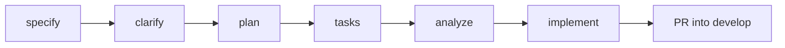

# Agentic Development Workflow

Every feature on this project went through the same spec-driven pipeline, with
[Spec Kit](https://github.com/github/spec-kit) providing the structure and Claude Code acting
as the coding agent. Over 20 features shipped this way.

## The pipeline

| Stage | Output | What it's for |
|---|---|---|
| **specify** | `spec.md`: user stories, functional requirements, success criteria, edge cases | Agree on *what*, before anyone thinks about *how*. |
| **clarify** | Up to five targeted questions, with answers written back into the spec | Catch ambiguity while it's cheap to fix. |
| **plan** | `plan.md`, `research.md`, `data-model.md`, `contracts/`, `quickstart.md` | Technical design, with every decision and rejected alternative recorded. |
| **tasks** | `tasks.md`, ordered by dependency and grouped by user story | Small steps an agent can carry out and a human can check. |
| **analyze** | A read-only consistency report across spec, plan and tasks | Find gaps (requirements with no task, tasks with no requirement) before writing code. |
| **implement** | Code, worked through `tasks.md` in order | The agent ticks off tasks, and every change traces back to a requirement. |

For a full example, see the sanitized artifacts for one feature in
[sample-spec/credit-watch-fallback/](sample-spec/credit-watch-fallback/): [spec](sample-spec/credit-watch-fallback/spec.md),
[research](sample-spec/credit-watch-fallback/research.md), [plan](sample-spec/credit-watch-fallback/plan.md) and
[tasks](sample-spec/credit-watch-fallback/tasks.md).

## Guardrails that made it work

- **One branch per feature, always cut from `develop`,** and merged through a pull request
  before the next feature starts. No stacked branches, so every spec builds on merged, reviewed
  code.
- **Plans must cite prior specs.** Before designing anything new, the agent checks earlier specs
  for an existing pattern or function to reuse. That's how the credit ledger reused the earlier
  "effective balance" approach instead of inventing a second one.
- **Decisions are written down, not remembered.** `research.md` records each decision, why it
  was made, and what was rejected, so later features (and later agent sessions) inherit the
  reasoning, not just the code.
- **Contracts for anything that crosses a team boundary.** When a feature depended on another
  team's API, the plan produced a handoff contract describing exactly what that endpoint must
  return.
- **Provisioning runbooks.** Any feature that needs a new third-party account ships with a
  step-by-step setup doc, so the agent's work can be deployed by someone else.
- **Manual validation scripts.** Each feature has a `quickstart.md` walk-through that a human
  runs before the PR merges.
- **A project context file** points the agent at the current feature's plan, so every session
  starts with the right stack, structure and commands.

## What I learned

The agent is only as good as the context and constraints you give it. Clear specs, recorded
decisions and a fixed process mean the AI makes the same choices a careful engineer would. They
also keep the codebase consistent from the first feature to the twentieth.
