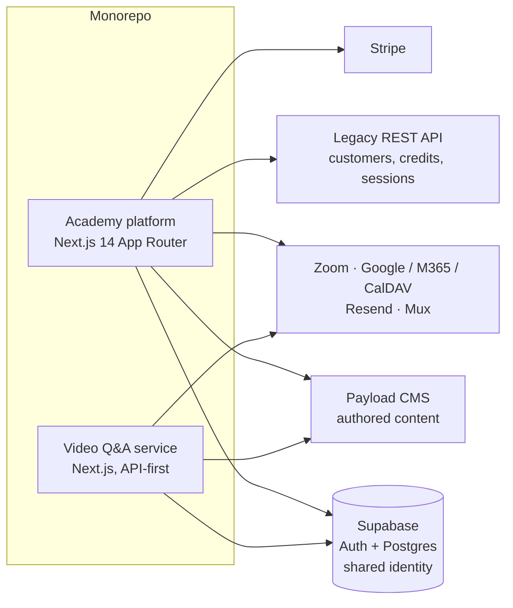

# Architecture

## Where data lives

The main design rule: put each kind of data where its write pattern fits best.

| Data | Store | Why |
|---|---|---|
| Courses, lessons, booking event definitions | Payload CMS | Staff-authored, rarely changes, needs an admin UI. |
| Time slots, bookings, enrollments, submissions | Supabase Postgres | Frequent writes, sensitive to concurrency, needs constraints. |
| Customer records, credit balances, legacy sessions | Legacy REST API | System of record owned by another team. Read-only from our side. |
| Local credit ledger, credit adjustments | Supabase Postgres | Lets us enforce credits before the legacy API supports writes. |
| Audit log, API keys, webhook deliveries | Supabase Postgres (shared) | Built once, reused by both services. |

## Key decisions

**One app with route trees, not more deployables.** Booking, live coaching and the staff
consoles are route trees inside the main app. The video Q&A service is the one exception: it has
its own video provider, bot protection and content store, and is meant to be embedded later.

**Integrate around the legacy API, don't wait for it.** Twice the plan depended on legacy
endpoints that didn't exist: an aggregate credit report and a credit write API. Both times the
answer was the same:
1. Build on endpoints that are proven to work.
2. Keep the response shape the same so the UI doesn't care which path produced it.
3. Label degraded data honestly in the UI ("partial data", "estimate").
4. Write a handoff contract so the real endpoint can be swapped in later.

**Fail closed on access, fail open on notifications.** Payment, tier and entitlement checks
block when they're misconfigured or unreachable. Emails and calendar syncs log their failures
but never undo a booking that succeeded.

**Swappable adapters at the edges.** Credits, entitlements and calendar providers sit behind
interfaces, so a provider can change without touching the booking flow.

**A versioned public API.** `/api/v1` with hashed bearer keys, read-only scopes, signed identity
handoff for a future mobile app, and outbound webhooks with a delivery log.
